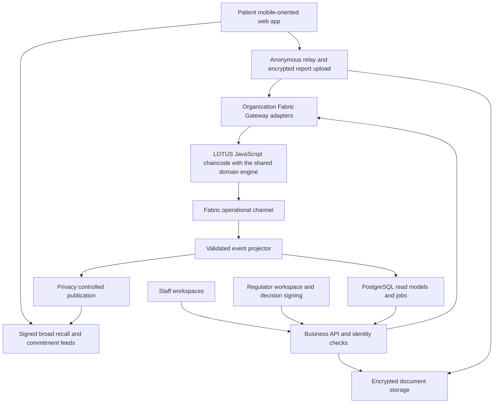

# LOTUS Hyperledger migration and application plan

Implementation update, 14 October 2026: [the toolchain migration](TOOLCHAIN_MIGRATION.md) maps the supplied synopsis to the delivered Fabric application and documents actual FireFly, Caliper, Brownie and IPFS integration. Treat this original plan as the target architecture; the linked guide distinguishes implemented behavior from research/deployment gates.

Planning baseline: 13 October 2026. Updated 14 October 2026 for the requested web-only implementation; see [application setup and verification](WEB_APPLICATION_GUIDE.md) for the delivered implementation and deployment limits. Scope: preserve every intended LOTUS capability and replace the demonstration infrastructure with an application that patients, pharmacies, distributors, manufacturers, prescribers, regulators, and recovery guardians can operate.

Use **Hyperledger Fabric for shared business rules**, a **mobile-oriented patient web application for private medicine records and recall matching**, and **desktop web workspaces for business operations**. Fabric is one part of the application. Authentication, durable storage, document delivery, notifications, integrations, recovery, and operational support must be built around it.

The current repository contains a working technical proof of concept. Its business rules and cryptographic work deserve preservation; its test identities, browser queues, direct blockchain access, and demonstration workflows need replacement. A new application must preserve the intended features without carrying forward inaccurate privacy, authenticity, or effectiveness claims.

## Assessment of the original proof of concept

The source paths in this assessment describe the 13 October baseline. The superseded demo UI, relayer and wireframes have since been removed; the implementation guides above describe the current code.

The existing contract suite passed **37 tests**, including real Groth16 proof verification; the SDK passed **4 tests**; the web production build succeeded during this assessment. These checks establish a runnable business-rule and cryptographic baseline. They do not establish production readiness, background alert delivery, real-world recall accuracy, or operation across independently managed organizations. The local Node runtime produced an unsupported-version warning from Hardhat; pin compatible runtimes for reproducible baseline runs. Browser end-to-end tests and coverage were not rerun in this assessment.

| Finding | Source evidence | Migration consequence |
| --- | --- | --- |
| Staff identities and recipients are demonstration accounts. | `apps/web/src/lib/chain.js`: `DEMO_ACCOUNTS`, `signerFor`; `lib/useActors.js`; role pages. | Replace account indices and the role tour with staff login, organization membership, facilities, professional permissions, and certificate-backed signing. |
| Business logic is more substantial than the screens. | `contracts/contracts/core/*.sol` implements custody, prescription balance, returns, shrinkage, batching, recall and expiry checks. | Port the rules and negative tests. Add operational screens for contract-only features. |
| Pharmacy queueing permits physical handover before validation. | `pages/Pharmacy.jsx` stores requests in localStorage and says to hand over medicine before submitting a batch. | Require a valid committed dispense before handover. A queue is a draft, not an inventory reservation or successful dispense. |
| Permit credentials enter ordinary EVM transaction arguments. | `DispenseLedger.DispenseRequest.permitSecret`; `PrescriptionRegistry.redeem`. | Pass permit credentials through Fabric transient data; never put them in public arguments, events, logs, or receipts. |
| Recall alerts run while the patient page is open and unlocked. | `pages/Patient.jsx`: 30-second interval; `public/sw.js` only displays notifications and caches the shell. | Add generic background wakeups, local matching and clearly visible synchronization status. Mobile operating systems can delay background work. |
| Side-effect narratives are not persisted for investigation. | `pages/Patient.jsx`: `reportCid = keccakId(text)`; relay receives the hash and proof, not the narrative. | Store encrypted report content durably and bind the stored object digest to the proof. |
| Certificates and manifests have hashes but no complete document service. | `Manufacturer.jsx`, `ShipForm.jsx`, `Verify.jsx` hash entered strings; verify shows a digest. | Upload, retrieve, authorize and verify the actual document bytes. An IPFS identifier and a content digest are different fields. |
| Recovery restores the root secret, not the complete wallet. | `patientStore.restoreWallet` resets permits and state; demo guardian shares use same-browser localStorage. | Preserve secret recovery and add encrypted recovery of permits, receipts and index allocation state. Distribute shares to independent custodians. |
| Commitment discovery can silently miss history. | `sdk/src/patient.js`: `matchRecalls` stops after 20 unused indices, while the UI can rotate unused codes. | Remove the fixed-gap assumption for normal operation; restore a backed-up high-water mark and all issued indices. |
| Regional suppression is based on units, and raw counts remain accessible. | `RecallRegistry.affectedCount`; public `DispenseLedger.unitsByLotRegion` and events. | A large fill for one person is not five people. Define the aggregation unit correctly and enforce privacy at the data-release boundary. |
| Recall effectiveness uses dispense records as its denominator. | `AnonymousSignals.recallEffectivenessBps` divides acknowledgements by `leafCount`, while nullifiers allow one acknowledgement per secret. | Preserve counts; describe denominator limits. Do not label this the percentage of distinct patients reached. |
| Verification overstates physical authenticity. | `Verify.jsx` declares a registered lot genuine; checks only product code and lot. | Show registered-lot status, expiry and recall separately. Copied labels can pass lot lookup. |
| Recall replay can target an unrelated lot. | `Regulator.jsx`: fallback to the next unrecalled demonstration lot. | Keep replay in a sandbox. Live imports must resolve exact identifiers or remain unresolved. |
| Reads and proof construction rebuild history. | `chain.js` queries events from block zero and loops through shipments; `lib/prover.js` loads all dispense events. | Add replayable projections, cursors, authenticated snapshots and privacy-conscious proof-data delivery. |
| Capacity and setup are bounded. | `LotTree.sol`: 65,536 leaves per lot, 32 recent roots; `circuits/setup.sh`: local ceremony fallback and a team phase-two contribution. | Introduce versioned tree segments and proof material. Production builds must fail if setup provenance is insufficient. |
| Reported precision and sensitivity come from synthetic cohorts. | `pipeline/cohort.py`, `pipeline/evaluate.py`; combined reach is modeled with conventional channels. | Retain the reproducible research pipeline, clearly separated from application and pilot performance. |

## Product scope and feature preservation

The matrix is the migration acceptance checklist. All rows are required for feature parity; a staged rollout changes delivery order, not the final scope. Demonstration and research capabilities remain available in an isolated environment.

| ID | Existing or intended capability | Required application behavior and owner | Acceptance condition |
| --- | --- | --- | --- |
| F01 | Five business roles, pseudonyms and regions | Organization/facility directory; manufacturer, distributor, pharmacy, prescriber and regulator permissions; operator administration. | A revoked or unauthorized actor cannot perform any protected action, including through direct API calls. |
| F02 | Lot registration and initial stock | Manufacturer registers product, lot, expiry, quantity and certificate; initial issuance occurs once. | Duplicate issuance fails and the accepted registration creates matching stock. |
| F03 | Certificate of analysis | Accessible, versioned certificate with issuer and content digest. | Downloaded bytes match the committed digest; access failures are visible. |
| F04 | Shipping with a manifest | Sender selects stock and recipient; creates a durable shipment and manifest. | Quantity leaves available stock once and remains in transit until resolution. |
| F05 | Recipient acceptance or rejection | Recipient accepts or rejects each shipment, with a durable receipt. | Acceptance creates received stock once; rejection restores sender stock once. |
| F06 | Multi-hop custody | Manufacturer, distributor and pharmacy can forward eligible stock; provenance survives each hop. | The path distinguishes pending, accepted and rejected legs. |
| F07 | Closure accounting | Pharmacy sees inbound, available, in-transit outbound, dispensed, returned and shrinkage quantities. | No operation creates negative stock or consumes more than accepted inbound. |
| F08 | Return to supplier | Return authorization, physical dispatch, acceptance and quarantine disposition. | Return stock cannot become saleable automatically; rejected return restores the correct bucket. |
| F09 | Shrinkage | Documented breakage, loss or destruction with evidence and reason. | Quantity and authorization checks apply; adjustments cannot erase history. |
| F10 | Prescription issue | Prescriber issues an expiring product permit with a fresh holder commitment and quantity. | Patient receives the credential; no durable patient identifier enters shared state. |
| F11 | Partial fills and quantity balances | Pharmacy redeems only the permitted product and available balance. | Two concurrent fills cannot jointly exceed the remaining balance. |
| F12 | Pharmacy binding and permit transfer | First fill binds the permit; patient-requested transfer moves the remaining entitlement. | Former pharmacy loses redemption authority after transfer; history remains intact. |
| F13 | Single dispense and split record | Committed dispense connects a lot to a fresh opaque commitment; identifying counter records stay local. | Stock, permit balance, uniqueness and tree membership change atomically. |
| F14 | Atomic batch dispensing | Durable encrypted draft queue; bounded, all-or-nothing batch submission. | One invalid item changes no balances; no queued item is presented as completed. |
| F15 | Expiry and recall blocking | Server and chaincode validate lot status and expiry on every dispense. | A recalled or expired lot fails even if a screen or projection is stale. |
| F16 | One-time counter codes and camera scanning | Patient shows a fresh commitment; pharmacy scans it and the actual shelf pack. | Patient root secret is absent from every QR, request and business log. |
| F17 | Patient medicine history and local matching | Receipts and commitment matching stay on the patient device. | A recall of lot A affects lot-A recipients without affecting same-product lot-B recipients. |
| F18 | Encrypted wallet, lock and recovery | Encrypted browser storage; explicit lock; automatic lock; recoverable web vault. | Storage failure blocks code issuance rather than silently losing index state. |
| F19 | Two-of-three guardians and personal guardian choice | Independent share handover, acceptance, recovery and replacement workflows. | Any two valid shares restore the secret; one share cannot; mismatched backup versions fail. |
| F20 | Regional languages | English, Hindi, Kannada and Telugu across onboarding, alerts and critical actions. | Reviewed translations and accessible labels cover complete workflows, not only banners. |
| F21 | Installable and offline patient experience | Mobile application plus browser fallback; cached receipts and signed recall bulletin. | Offline screens show their last successful check; new proof submission waits for connectivity. |
| F22 | System recall notifications | Generic broadcast wakeup; private local recall matching; affected-lot inbox. | Locked-device notifications disclose no medicine; delayed delivery has an explicit fallback. |
| F23 | Gas-free and wallet-free patient submissions | Anonymous proof relay submits Fabric transactions. | No patient needs a Fabric certificate, cryptocurrency or staff login. |
| F24 | Verified anonymous adverse-event reports | Device proof plus encrypted narrative; one report per root secret per lot. | Invalid membership and changed severity/content fail; successful reports are retrievable by authorized safety staff. |
| F25 | Safety signal threshold and severity summary | Verified counts raise an investigation item with provenance and configurable policy. | Threshold event does not itself issue a recall or claim medical causation. |
| F26 | Anonymous recall acknowledgements | Patient chooses stopped using, returned, or consulted doctor; one acknowledgement per secret per recall. | Duplicate submissions do not increase counts; every affected recall is selectable. |
| F27 | Lot recalls with classification and reason | Regulator signs a lot-scoped Class I, II or III decision with a retrievable notice. | Only active regulator authority can issue a recall; original decision is immutable. |
| F28 | Crowd-signal provenance for recalls | Investigation links evidence to the signed recall decision. | Decision distinguishes imported notice, manual action and patient safety signal. |
| F29 | Regional heat map and small-cell suppression | Privacy-controlled aggregates with clear units and complementary suppression. | Exports and combined filters cannot recover suppressed cells trivially. |
| F30 | Recall response accounting | Counts by action; dispensed units and records shown separately. | No screen claims unique-patient effectiveness from a dispense-record denominator. |
| F31 | Public medicine verification | No-login scanner/manual entry, lot status, custody summary, certificate and notice. | Registered, not found, expired, recalled, offline and unknown are distinguishable. |
| F32 | External recall data and exact lot parsing | Source-preserving openFDA connector and reviewable exact-product/lot candidates. | Ambiguous scope is unresolved; unrelated lots are never selected as a fallback. |
| F33 | Live replay and product-versus-lot comparison | Sandbox uses imported or illustrative notices with explicit labels. | Replay cannot access live signing keys or production inventory. |
| F34 | Red-team, synthetic evaluation and reproducibility | Retain simulations, cohort generation, source manifests and independent benchmark reports. | Synthetic results are labeled; byte-identical regeneration remains available. |
| F35 | Deployment, tests, benchmark and demonstration tooling | Repeatable Fabric environments, end-to-end checks, operational benchmarks and sandbox walkthrough. | A clean environment runs the real flow without unlocked development accounts. |

## Target architecture

### Application components

| Component | Proposed implementation | Responsibility |
| --- | --- | --- |
| Patient application | Responsive React PWA; local crypto package; encrypted IndexedDB vault; browser notifications. | Private wallet, receipts, QR exchange, local recall matching, proof generation and guardian recovery. |
| Patient and public browser access | React with TypeScript; responsive public verify and patient fallback PWA. | Reach users without installation; provide cached access with explicit browser limitations. |
| Operations portal | React with TypeScript; role-specific routes and shared design system. | Inventory, custody, dispensing, prescribing, safety investigation and administration. |
| Business API | NestJS with TypeScript, structured modules and OpenAPI contracts. | Authentication, tenant checks, commands, uploads, read APIs and integrations. Start as a modular application, not dozens of services. |
| Anonymous ingress | Separately deployed relay with no patient account requirement. | Proof validation for abuse control, encrypted uploads, submission receipts and retries; final proof authority remains chaincode. |
| Fabric adapter | Server-side Fabric Gateway client. | Endorse, submit and wait for validated commits using managed identities. |
| Shared rule execution | JavaScript chaincode with the shared domain engine with domain modules in one package. | Atomic lot, custody, permit, dispense, recall, root and nullifier state transitions. |
| Read model and workflow storage | PostgreSQL with tenant-scoped tables; durable jobs and projection checkpoints. | Search, dashboards, drafts, integration inbox, notification jobs and commit-status tracking. |
| Documents | S3-compatible object storage with encryption, access policies, malware checks and retention controls. | Certificates, manifests, recall notices and encrypted safety narratives. |
| Identity and keys | OIDC identity provider for staff; Fabric CA/MSPs for organizations and signing identities; managed key vault/HSM where supported. | Staff sessions, professional permissions, certificate lifecycle and protected signing. |
| Integration workers | Versioned connector modules and durable queues. | openFDA imports, pharmacy/POS/WMS/EHR adapters, webhooks and reconciliation. |

PostgreSQL owns drafts and operational workflows; Fabric owns finalized shared stock and entitlement state. The database must not independently authorize dispensing. Object storage owns document bytes; the ledger owns digests and immutable references. Events rebuild read models after loss or corruption.

### Fabric choice and network boundaries

Use **Fabric 3.1.5 as the initial compatibility baseline**, verified against the official release page for this plan; recheck and pin patch versions and image digests when implementation begins. Select compatible Fabric CA, Gateway and chaincode libraries through a tested version manifest. Fabric offers organization identities, configurable endorsement and selective sharing without patient gas fees. [Fabric release](https://github.com/hyperledger/fabric/releases/tag/v3.1.5).

Use one operational channel, `lotus-operations`, for stock, prescriptions, dispensing and recalls. Keeping their authoritative state together avoids asynchronous cross-channel safety checks. A pilot has separate organizations for a manufacturer, distributor, Pharmacy A, Pharmacy B, clinician organization and independent privacy validation operator. These represent independently administered entities; a business role is an attribute within an organization, not automatically a separate MSP. Larger pharmacy groups can model facilities within one organization.

**Regulators receive published safety data and submit signed decisions through the application. They do not operate a raw-ledger peer on this channel.** This is a deliberate privacy decision: merely hiding fields in their dashboard cannot prevent a peer operator from reading raw events. Chaincode verifies regulator command signatures against approved authority keys in the actor registry. The submitting relay cannot invent a regulator decision. Regulators can audit public anchors and authorized releases without receiving patient-counter metadata. If a partner insists on unrestricted regulator peer access, the privacy model must be redesigned before launch.

Use four independently administered SmartBFT orderers for a production consortium that must tolerate one malicious ordering node. A small integration environment can start with three Raft orderers, but Raft supplies crash tolerance rather than Byzantine tolerance. Two peer instances per operational organization are the initial availability target. Neither an orderer nor a validator can be marketed as independent when all its administrator keys belong to the same operator. [Ordering services](https://hyperledger-fabric.readthedocs.io/en/latest/orderer/ordering_service.html).

The independent privacy operator is a real trust and availability dependency. Its staff and peers may see permitted operational data but must never receive patient root secrets or a centralized medicine-to-person directory. Consortium agreements define operator replacement, key revocation, upgrade approval, dispute resolution, data access and emergency response. These responsibilities cannot be supplied by the software alone.

### Chaincode and endorsement plan

Port the seven contracts into modules in a single JavaScript chaincode with the shared domain engine package: `Actors`, `Lots`, `Custody`, `Permits`, `Dispenses`, `Recalls`, and `Signals`. Add `Documents`, `ProofVersions`, and `Migration` as supporting modules. A single `Dispense` invocation updates custody, permit balance, commitment uniqueness, tree state and audit event in one transaction.

| Command | Caller authority | Required endorsement intent |
| --- | --- | --- |
| Register lot and issue initial stock | Active manufacturer organization and authorized staff | Manufacturer plus independent privacy validator. |
| Create outbound shipment | Current holder and authorized dispatch staff | Sender plus privacy validator; stock is locked in transit. |
| Accept or reject shipment | Named recipient organization and authorized receiver | Sender, recipient and privacy validator endorse the previously created shipment state. |
| Record shrinkage | Stock owner with authorized inventory permission | Owner plus privacy validator. |
| Issue permit | Active prescriber with verified professional authority | Prescriber organization plus privacy validator. |
| Bind, redeem or transfer permit | Current pharmacy authority and required holder credential/request | Pharmacy plus privacy validator; transfer additionally records a valid patient request and target. |
| Dispense or dispense batch | Authorized pharmacy facility | Pharmacy plus privacy validator, satisfying every touched stock/permit/root policy. |
| Issue recall | Signed command from an active regulator authority | Privacy validator plus an approved independent operational validator; manufacturer consent is not required. |
| Report or acknowledge | Valid ZK proof, submitted by authorized relay | Privacy validator plus an independent validator verifies the same proof and consumes the same nullifier. |
| Change actor authority, proof keys or thresholds | Consortium governance approval | Agreed governance quorum; changes are versioned and audited. |

The table describes policies to implement and test, not automatic function-level behavior supplied by Fabric. Use state-based endorsement on existing keys, collection policies where private state is touched, and signed business authorization checked by chaincode. Shared dispense-root keys require the privacy validator; the touched pharmacy stock and namespace keys additionally require that pharmacy, so unrelated peers are not required to see transient permit credentials. Signal/nullifier commands use a separate policy requiring privacy plus an independent validator. Creation is also protected: a permissive default for new keys must not allow an organization to mint or recall alone. Bootstrap each state class through governance-controlled namespace/anchor records that the corresponding creation command reads and updates; reading a policy-protected key alone does not enforce its endorsement policy on a transaction. Use per-owner/per-operation anchors to avoid a global bottleneck. Test policy installation and updates using real invalid endorsements, not only mocked calls. [Gateway endorsement rules](https://hyperledger-fabric.readthedocs.io/en/latest/gateway.html).

For dispensing, the prescription secret is transient data delivered only to explicitly selected pharmacy and privacy peers. Other validators can verify a root or signal transaction without seeing that credential. The combination of every key policy and collection policy must have a satisfiable endorsement plan; a privacy-restricted proposal must fail instead of being forwarded to unauthorized peers. Collection definitions, replication counts and peer targeting are tested together. [Transient-data handling](https://hyperledger-fabric.readthedocs.io/en/latest/private-data-arch.html).

### State and data ownership

| Data | Authoritative home | Exposure |
| --- | --- | --- |
| Organization, facility, role and authority status | Actor registry plus credential directory | Operational identities; published actor summaries where appropriate. |
| Product identity and lot metadata | Ledger; product catalogue projection | Public subset includes product, manufacturer, lot, expiry and permitted certificate details. |
| Stock and shipment state | Ledger | Operational consortium; public verification receives an approved custody summary. |
| Permit holder commitment, balance, expiry and pharmacy binding | Ledger, under random permit ID | No patient name, root secret or durable patient account; transaction correlations remain a documented residual. |
| Permit secret | Patient vault and a transient pharmacy submission | Not persisted in ledger, database logs, analytics or public receipts. |
| Dispense commitment, tree and root version | Ledger; signed feed mirrors | Published proof feed strips pharmacy, region, exact counter time, permit ID and quantity. |
| Counter identity or EHR record | Pharmacy/clinician's existing local system, if needed | Institution's own authorization boundary; never copied into consortium patient state. |
| Certificates, manifests, notices | Encrypted object storage with ledger content digest | Audience-specific access; only immutable versions can be referenced by finalized commands. |
| Commercial details requiring shared confidentiality | Explicit private data collection or separately encrypted object | Named parties only; do not create a collection per patient. |
| Side-effect narrative | Object encrypted to safety-investigation recipients | Authorized safety staff; ledger holds digest, severity and proof metadata. |
| Patient root secret, receipt list and matching result | Patient device and end-to-end encrypted backup | Device and approved recovery parties; server holds ciphertext only. |
| Guardian share | Guardian device or independently managed encrypted vault | That guardian and patient recovery exchange. |
| Push token | Minimal delivery service | Generic bulletin subscription; no medicine subscription or patient commitment. |

Fabric private data collections share actual values only with authorized organizations but still place hashes on the channel. They are useful for commercial confidentiality, not an anonymity system or a substitute for ZK proofs. Predictable private values require client-generated salts; do not expose private values through chaincode response payloads. Sensitive object metadata and operational logs need the same care as ledger fields. [Private data architecture](https://hyperledger-fabric.readthedocs.io/en/latest/private-data/private-data.html).

Use positive integer quantities in a fixed base unit, explicit pack-to-unit conversions and decimal-string API encoding. Avoid JavaScript number conversion for ledger quantities. Product identifiers carry their namespace: retain NDC for imported US records and add local catalogue/GTIN identifiers through explicit mappings. Existing lot keys remain stable aliases; new canonical keys include issuer identity to prevent accidental cross-manufacturer collisions. Never equate similar product names or different packaging codes silently.

### Transaction lifecycle and failure handling

Commands include `requestId`, organization/facility, schema version and a payload digest. The API returns a durable command receipt; the screen displays draft, submitting, committed, rejected or awaiting confirmation. Successful endorsement or submission alone is not success. Complete an action only after a **valid commit**. Project only valid transactions; a later projection delay cannot reverse a completed ledger action.

Store idempotency in ledger state as well as the API. A repeated request with the same digest returns its outcome; the same ID with different content fails. After a timeout, reconcile the original transaction before resubmitting. A rejected transaction may be retried with a new Fabric transaction ID and the same business request ID after revalidation. Use explicit key reads for stock, permit, recall status, nullifier absence and tree state so concurrent operations conflict safely through Fabric version validation. [Read and write semantics](https://hyperledger-fabric.readthedocs.io/en/latest/readwrite.html).

Batch logic must maintain an in-memory working state for repeated writes to the same key; Fabric reads do not automatically return a value just written within the same simulation. Test multiple fills against one stock key and one permit in the same batch. Do not use database search results or a rich query as the authoritative basis for a decrement.

Use deterministic canonical serialization, integer arithmetic, stable iteration and an approved transaction timestamp policy. Chaincode does not call an external proof verifier, product API or clock during simulation. Transaction timestamps are client supplied; ingress checks alone cannot stop a credentialed caller from bypassing the API. Define a signed time-attestation protocol with independent validator approval and short validity windows; chaincode checks the attestation, its sequence and the expiry boundary deterministically. Clock drift, stale/replayed attestations and loss of time authority must fail safely. Cross-organization endorsers must produce identical results.

Workers consume committed events using saved block and transaction checkpoints. The projection transaction updates views and schedules jobs atomically. Jobs, notifications and webhooks are at-least-once with deduplication, bounded retries, visible failures and safe replay. Sensitive request bodies are excluded from telemetry.

## Privacy and cryptographic design

### Patient membership and anonymous signals

Preserve commitment derivation and topic-specific nullifiers. A report proves possession of a secret whose commitment is present in a lot tree. It does not prove one unique human, clinical causation, or honest dispensing by a colluding institution. Describe spam resistance as **one signal per patient root secret per topic**; a person with multiple roots is not automatically prevented from producing multiple signals.

Retain browser-side Circom/snarkjs proving and deterministic verification inside JavaScript Fabric chaincode. The patient secret never goes to a server. Use the same real proof vectors and tampered-signal fixtures against the existing Solidity verifier and the shared Fabric verifier. This gate has passed on the local two-organization Fabric acceptance channel. A reviewed production circuit/setup and independently operated endorsement topology remain deployment gates.

New proof domains include application ID, deployment/network ID, proof version, operation type and lot or recall ID. Chaincode recomputes the expected domain and content digest rather than trusting caller-supplied public inputs. Historical proof domains and migrated roots remain available only in an explicitly scoped legacy verifier path. Nullifier history is imported or bridged so migration cannot enable previously consumed signals to be replayed.

Replace the 65,536-leaf ceiling with **versioned segments per lot**. Start a new segment when the old one fills; preserve the same lot-wide report domain so a second segment does not allow a second report for the same secret. Every proof identifies its tree segment and verifier version. Retain committed roots according to a documented validity policy rather than expiring after 32 insertions. A recall records a cutoff state; proofs against post-cutoff membership must not count as affected recipients. Do not put one global leaf counter or global root key on every dispense; benchmark contention on popular lots and segment rollover.

Published commitment feeds contain sufficient leaves and roots for local verification and matching but no personal identity or counter metadata. Supply signed snapshots and paginated append-only deltas over broad fixed partitions. Querying a patient's exact commitment or leaf index would expose which receipt belongs to them; downloading only their lot histories can reveal medicine interests. Normal clients fetch shared broad partitions, use locally saved receipt witnesses and refresh them from common deltas. Proof requests must never upload the patient secret.

Separate safe dispensing from public publication timing. Finalize a dispense before handover, then release its reduced public proof data in fixed epochs without counter timestamps or permit references. Bounded atomic batches remain supported. They reduce some outsider timing information but cannot promise anonymity at a quiet counter or against authorized operational peers that see the transaction. Staff waiting for a batch commit must see the actual delay; hourly physical handover before commit is not an acceptable privacy workaround.

Full recovery without receipts may require downloading a historical commitment corpus and scanning an explicit index range. Back up the issuance high-water mark and reservations. Measure bandwidth, device memory and time at pilot scale before promising unlimited phone-only recovery. If broad download becomes impractical, a reviewed private-retrieval protocol is required; silently replacing it with per-patient server matching would break the feature.

### Background recall delivery

The patient PWA fetches a broad recall bulletin and matches locally while it is open and unlocked. Opted-in system notifications use generic wording. Cached bulletins support explicit stale/offline checks. Production generic Web Push delivery can wake opted-in browsers, but web-only operation does not guarantee unattended private matching while locked. Conventional recall channels continue. Device detection and message reach must be measured separately from bulletin publication.

### Regional aggregation and effectiveness

Separate **units**, **dispense records**, **anonymous acknowledgements** and **distinct patients**. The current privacy scheme does not give an exact unique-person denominator without an additional privacy protocol. Display acknowledgement counts by action and, if desired, an explicitly labeled acknowledgement-to-dispense-record ratio. Do not call it a patient reach rate. Phone notification delivery is also different from reading an alert or physically returning stock.

Apply regional release thresholds to a defined record cohort, with coarse geography, fixed reporting windows and complementary suppression. Five records still do not prove five distinct people; the UI must say what is counted. Hide or merge additional cells where global totals or neighboring reports would reveal a suppressed value. Regulator APIs and exports receive only approved releases. No regional raw query, proof feed, or public custody view may reintroduce the suppressed mapping. Repeated releases, timing, collusion and unusual medication patterns remain part of the privacy audit.

### Recovery and key custody

Provide two-of-three recovery with patient-selected professional or personal guardians and confirmed independent handover. The root secret, encrypted backup decryption material, wallet schema, allocated indices and credential backup all need versioned recovery. A guardian stores one share, never the full set. A central operator must not hold two shares under different labels.

Use an end-to-end encrypted backup object with an opaque recovery reference. A recovery package restores receipts, active permits and allocation state as well as the root secret. Combine shares locally on the recovered device. Handle unavailable guardians, duplicated shares, backup version mismatch, device replacement and interrupted restore. A replacement guardian requires resharing and a new backup version; changing a display name is not a security change.

Guardian recovery cannot revoke knowledge already learned by a stolen unlocked phone or colluding guardians. Rotating the active root protects future receipts but old receipt ownership remains tied to the old secret. Preserve old roots locally for historical matching and proofs; explain this limit to users and document incident handling.

## Stakeholder interfaces

Use one visual system with distinct role workspaces. Patients receive a mobile-oriented PWA; operational staff receive desktop-first web tools with a scanning view on phones or handhelds. All interfaces run in a browser. No native mobile or desktop application is part of this scope.

The responsive interfaces are now implemented in `apps/web/src/application`. The earlier illustrative planning wireframe has been removed; use the application guide to inspect the working screens.

| Stakeholder | Primary interface | Navigation | Main actions |
| --- | --- | --- | --- |
| Patient/customer | Mobile-oriented PWA | Home, Medicines, Counter code, Alerts, Help and recovery | Scan prescription, present code, review receipt, check recalls, acknowledge, report symptoms, manage guardians. |
| Public visitor | Mobile-friendly verification website | Scan or manual entry, Result, Certificate, Recall notice | Verify lot status without an account. |
| Manufacturer and quality staff | Desktop web | Overview, Products and lots, Certificates, Shipments, Returns, Recall response | Register lot, attach CoA, dispatch, investigate affected stock, receive returns. |
| Distributor/warehouse staff | Desktop web and handheld scanning view | Tasks, Inventory, Incoming, Outgoing, Returns, Exceptions | Receive or reject stock, pick by lot, dispatch, quarantine and reconcile. |
| Pharmacy staff | Counter web workspace and optional handheld | Counter, Inventory, Incoming, Returns and losses, Permit transfers, Reconciliation | Scan pack and patient code, dispense, batch, return, record shrinkage, handle recall stock. |
| Prescriber | Desktop/tablet web | Issue prescription, Active permits, Transfer requests, Recovery requests | Issue and hand over permit, inspect permissible balances, participate as a chosen guardian. |
| Regulator/safety staff | Desktop web | Safety inbox, Investigations, Recalls, Regional view, Response accounting, Imports | Review verified reports, resolve imported scope, sign recall, inspect approved aggregates. |
| Guardian | Minimal mobile web view; professional task panel | Share acceptance, Recovery requests, Share replacement | Accept one share, approve release to a verified recovery session, replace a share. |
| Consortium operator | Separate administration web area | Organizations, Facilities, Access, Credentials, Jobs, Network, Audit | Onboard actors, revoke access, rotate keys, monitor projections and perform recovery drills. |
| Auditor | Read-only authorized web view | Lot history, Evidence, Decisions, Releases, Exports | Verify custody and document provenance within an approved scope; no patient directory. |

### Patient journey and screens

**Home** prioritizes affected recalls, last check time and a large “Show pharmacy code” action. It says “No matching recalls as of [time]” after a complete check; offline, incomplete or failed checks never produce a green safety verdict. Medicine cards use medicine names, lot, quantity and pharmacy receipt information stored locally.

**Prescription import** scans a clinician's code, verifies the issuer and expiry, saves the credential durably and shows the available quantity. Manual import and a secure desktop-to-phone handover support camera failures. No feature assumes the prescriber and patient share a computer.

**Counter code** asks which prescription to use and shows a time-limited pharmacy-session QR containing a one-time commitment and securely exchanged redemption credential. It never includes the root secret. A fresh index is persisted before display; cancelled indices remain in backup state. The screen waits for a verified receipt and only then shows the medicine as received.

**Recall detail** shows the exact affected medicine and lot, notice source, issue time, approved instructions and pharmacy/doctor contact options. The three existing acknowledgement actions remain. Patients can select any affected recall; the app shows pending, accepted or already acknowledged status. A self-reported return acknowledgement is not presented as a warehouse-confirmed return.

**Side-effect report** selects a received medicine, severity and narrative, explains who can decrypt the narrative, generates a proof locally, then shows a durable submission receipt. Names, contact details and identifying attachments are excluded by default; the patient previews the content before release. Free-text self-identification can still defeat anonymity and must not be described as cryptographically prevented. Upload and proof failures retain an encrypted draft. A report is not shown as accepted until a valid committed signal exists.

**Recovery** shows guardian acceptance status, backup freshness and what will be restored. A guided flow requests two independent shares, verifies the package, restores locally and rechecks recall status. Support personnel cannot request the root secret or obtain two guardian shares.

### Distributor and manufacturer journeys

The distributor home is a task queue: shipments awaiting receipt, pickups ready to dispatch, recall quarantines, unresolved discrepancies and aged in-transit stock. Inventory tables show product, lot, expiry, facility/bin and available versus quarantined/in-transit quantities. Search and barcode scans are available on every stock operation.

Receiving opens a shipment detail with sender, destination, manifest, expected lots and quantities. Staff scan the received pack, confirm quantities and choose accept or reject with a reason. The initial protocol keeps whole-shipment acceptance/rejection; a discrepancy remains quarantined and disputed until a corrected shipment or explicit compensating transfer is recorded. Partial receiving can be added as a separately specified extension, not inferred from the old model.

Dispatch selects eligible stock, recipient facility and quantity, attaches a manifest and commits a shipment. The interface prevents selecting another tenant's inventory. Quarantined/recalled stock can move through a documented return/disposal route but never through ordinary saleable dispatch. Carrier scans and delivery evidence are operational observations; only the named recipient can accept custody.

Manufacturer quality staff register a product lot, upload and verify the CoA, then approve initial stock issuance. A lot detail page joins certificates, stock holders, shipments, recalls and return disposition. The public site receives only the approved certificate version and custody summary, excluding prices, exact warehouse locations and counter data.

### Pharmacy and prescriber journeys

The pharmacy counter is a focused screen: scan shelf pack, scan patient code, confirm product and permit, enter quantity, review checks, submit, wait for a committed receipt, then hand over. Errors identify wrong product, insufficient stock, exhausted/expired permit, other-pharmacy binding, recalled/expired lot and synchronization failure. Barcode scanner keyboard input, cameras and manual entry all work.

Batch mode collects encrypted drafts and validates their combined stock and permit requirements. A pharmacy submits a bounded batch and waits for the whole batch to commit before completing its handovers. Failed batches explain the offending items without silently dispensing the others. A production background job can submit queued drafts, but a browser tab is never the only durable queue. A network outage pauses finalized dispensing in LOTUS; any separate institutional emergency procedure is recorded as an exception, never portrayed as an already committed transaction.

The pharmacy inventory workspace adds the missing return, shrinkage and permit-transfer interfaces. Recall work creates a quarantine task, a stock reconciliation and patient-help instructions. A returned patient's pack is documented locally and counted through the correct ledger return/stock rules; its acknowledgement proof is not needed to identify the patient centrally.

The prescriber workspace chooses a catalogue product, quantity and validity period, signs issuance and hands the credential to the patient by QR or protected transfer. Permit IDs come from transaction results, not a guessed count before submission. Clinical identity and diagnosis stay in the clinician's local record system. Active-permit and pharmacy-transfer views expose only authorized data.

### Regulator and administration journeys

Safety staff open an investigation when verified reports cross the configured threshold. They can retrieve authorized encrypted narratives, see provenance and severity summaries, and record a decision. The recall composer selects the exact product/lot, class and notice, previews scope and instructions, and requires a signed regulator authorization. The manufacturer cannot veto a valid recall.

Regional dashboards use approved release cohorts and label suppression. Response accounting separates stock still held, units dispensed, anonymous acknowledgements by action and confirmed institutional returns. Imports show exact matched lots, ambiguous candidates, source notices and unparseable scope. “All lots” must be handled as explicit source scope, never as an empty lot list that selects an arbitrary lot.

Operators have a separate access and health workspace: organization/facility onboarding, actor revocation, certificate expiry, signer rotation, failed jobs, private-data availability, projection lag and backup drills. Auditors receive scoped read-only exports with document digests and transaction provenance. No administration feature becomes a patient medicine search service.

### Shared interface rules

Use clear product names alongside identifiers; hide blockchain terminology from normal tasks. Every action has draft, pending, committed and error states with recoverable input. Display the organization and facility in the workspace header. Organization switching requires explicit membership; selecting a different role does not grant privileges. Support keyboard-only use, readable contrast, large scan targets, low bandwidth, language selection and narrow screens.

Public verification says “Registered lot; no active recall found as of [time]”, not “Genuine and safe”. A not-found result says the lot cannot be verified from this registry. Retain the intended counterfeit warning as a possible risk, while acknowledging incomplete coverage and cloned labels. Pack serialization and duplicate-scan investigation are useful later extensions; they are not evidence that the existing batch check authenticates a physical pack.

## API and integration plan

Business routes use authenticated organization/facility scope. Anonymous routes have no staff session requirement and do not collect a patient identifier.

| API family | Representative operations | Contract requirements |
| --- | --- | --- |
| Identity/directory | `/v1/me`, `/organizations`, `/facilities`, `/actors` | Tenant filtering, active authority and permissions. |
| Lots/documents | `POST /lots`, `GET /lots/{id}`, `/documents/uploads` | Versioned product identifiers; immutable document reference and content digest. |
| Inventory/custody | `/inventory`, `POST /shipments`, `/shipments/{id}/accept`, `/reject`, `/returns`, `/shrinkage` | Request ID; exact units; expected state version; valid commit receipt. |
| Prescriptions | `POST /permits`, `/permits/{id}/transfer` | Fresh holder commitment; protected credential exchange; bounded product and quantity. |
| Dispensing | `POST /dispenses`, `POST /dispense-batches` | Sensitive credential removed from ordinary ledger arguments; atomic balance and uniqueness checks. |
| Recalls | `/recalls/drafts`, `/recalls/{id}/issue`, `/notices/imports` | Regulator-signed canonical command; exact lot scope; immutable issued decision. |
| Anonymous signals | `/anonymous/report-uploads`, `/anonymous/reports`, `/anonymous/acks` | Versioned proof envelope; no secret; size limits; anonymous receipt capability. |
| Privacy feeds | `/public/bulletins`, `/public/commitments?partition=&cursor=`, `/public/roots` | Broad partitions; signatures; cutoff/version data; no regional counter metadata. |
| Public verify | `/public/verify`, `/public/certificates/{id}` | Minimal published facts, freshness and explicit unknown/offline states. |
| Operations | `/commands/{id}`, `/jobs`, scoped webhooks | Commit status and projection checkpoint; no sensitive request echo. |

Use structured errors such as `LOT_RECALLED`, `LOT_EXPIRED`, `PERMIT_EXHAUSTED`, `STOCK_CONFLICT`, `ALREADY_SUBMITTED`, and `COMMIT_UNKNOWN`. Anonymous command-status access uses a high-entropy receipt capability, not enumeration by predictable ID. Abuse controls protect proof-verification capacity without requiring patient accounts; logs do not turn rate limits into a long-lived patient tracking system.

The openFDA adapter preserves original records, fetch time, source ID, digest and parsing version. It creates candidate notice matches; it does not automatically issue a regulator decision. Pharmacy/POS, WMS and EHR integrations use the same command APIs as the interfaces, never bypass chaincode. Connector failures are visible in an inbox with deduplicated retry and reconciliation.

## Code migration and data cutover

| Existing area | Treatment |
| --- | --- |
| `contracts/contracts/core` | Preserve as the executable behavioral reference; rewrite in the shared JavaScript domain engine with parity tests. Solidity does not execute natively in Fabric. |
| `contracts/contracts/privacy`, `circuits` | Preserve proof semantics and fixtures; port verifier, audit constraints/setup, introduce version manifests and domain separation. |
| `sdk/src` | Move useful crypto/tree/recovery logic into typed shared packages. Remove EVM-only proof serialization from the core abstraction. |
| `apps/web` | Reuse proven interaction ideas, scanner integration and language assets; rebuild screens around authenticated APIs and durable commands. |
| `apps/relayer` | Replace the development key, synchronous submission and broad request handling with an isolated anonymous gateway and receipt store. |
| `pipeline` | Keep research generation/evaluation and manifests; turn source fetching into a production adapter with provenance and exact scope. |
| `redteam` | Retain historical simulations; add Fabric, network metadata, key custody, import and device adversaries. |
| `scripts`, CI, docs | Preserve a sandbox walkthrough; add real network integration, deployment manifests, recovery checks and separate measured reports. |

Proposed structure: `apps/operations-web`, `apps/patient-web`, `apps/public-web`, `services/business-api`, `services/anonymous-relay`, `services/projector`, `packages/domain`, `packages/api-contracts`, `packages/patient-crypto`, `packages/ui`, `chaincode/lotus`, `infra/fabric`, `infra/deploy`, `tools/migration`, and `tests/acceptance`. These are module boundaries; shared packages should avoid duplicating business rules or leaking server secrets into mobile builds.

First discover whether any persistent EVM deployment holds real data. The repository contains deployment tooling, not proof of a live deployment that needs import. If all data is demonstration data, start production empty and seed only the sandbox. Do not import synthetic patients or invented stock into production.

If a real ledger exists, use the following cutover:

1. Inventory chain IDs, deployment addresses, actor credentials, block range, stock, pending shipments, permits, recalls, commitments, roots and consumed nullifiers. Keep raw chain archives and import manifests.
2. Map EVM actors to approved organizations/facilities. Verify unit conversions and canonical product mappings. Preserve old lot/permit/recall IDs through aliases; never regenerate patient commitments.
3. Reconstruct valid state from storage and events. Reconcile stock conservation, pending transfers, remaining prescription balances, roots, counts and nullifiers. Unresolved mismatches block that scope's cutover.
4. Run shadow comparisons with EVM as the only writer. Replay source events into a non-production Fabric rehearsal, compare outcomes and test patient history/proofs through the compatibility layer. Do not dual-write live inventory.
5. Announce a bounded write pause for the migrated scope. Freeze the source at a signed block checkpoint, drain committed activity, and import through a temporary governance-authorized migration path. Preserve provenance for every imported record. Disable migration authority after validation.
6. Switch APIs, integrations and patient feeds to Fabric together. Encrypted wallet migration happens on the patient device; expired or missing permit credentials require the appropriate reissue/restore flow. Keep the source ledger read-only for audit.
7. Before the first new Fabric write, rollback may return to the frozen EVM source. After new Fabric writes, rollback requires reconciliation and forward/compensating records; restoring a stale source snapshot would lose real operations. Rehearse both procedures.

## Delivery sequence and milestones

Indicative effort assumes four experienced engineers sharing backend/Fabric, web/privacy, operations frontend and deployment/testing responsibilities, with product/design and security review support. Allow **16 to 24 calendar weeks for a supervised pilot**. Consortium onboarding, integration availability, device support and cryptographic review can extend this. One developer should plan substantially longer. These are planning estimates, not a fixed bid or a promised completion date.

| Phase | Indicative duration | Concrete deliverable | Exit gate |
| --- | --- | --- | --- |
| 0 Scope and technical gates | 1–2 weeks | Approved F01–F35 checklist, product catalogue assumptions, wireframes, organization model, real Groth16 proof verified inside Fabric. | Proof encoding/verifier works; privacy and endorsement topology is feasible. |
| 1 Application foundation | 2–3 weeks | Staff auth, directory, protected signing, CI, Fabric network, API contracts, command receipts, projections and document storage. | No development identity can run in production mode; restart and replay preserve status. |
| 2 Inventory and custody | 3–4 weeks | Manufacturer/distributor workspaces, lot issuance, documents, shipping, receiving, rejection, returns and shrinkage. | Multi-organization inventory conservation and wrong-tenant tests pass. |
| 3 Prescribing and dispensing | 3–4 weeks | Prescriber and pharmacy workspaces, QR exchange, partial fills, binding, transfer, single/batch dispensing and durable receipts. | Concurrent balance tests and failed-batch tests pass; handover requires commit. |
| 4 Patient privacy and safety | 4–6 weeks | Patient PWA, local matching, all languages, guardians/full recovery, encrypted reports, anonymous ACKs, thresholds, recalls and regional releases. | Real proofs, background/offline behavior, privacy adversaries and recovery pass on target devices. |
| 5 Integrations and pilot operation | 3–5 weeks, partly overlapping | Public verify, source imports and sandbox replay, selected WMS/POS/EHR connector, measured load tests, cutover rehearsal and operating runbooks. | Every F01–F35 row passes; independently managed pilot users complete the end-to-end flow. |

Start by proving the Fabric verifier and building one complete vertical slice: manufacturer registers a real test lot, distributor and pharmacy accept stock, prescriber issues a permit, patient obtains a receipt, regulator signs a recall, and the same patient privately acknowledges it. Build remaining exception paths on that working slice. Do not postpone anonymous proofs and recovery until after a public-data application has already established the wrong data model.

No feature is removed to meet an early milestone. A partial milestone is a development release, not a claim of feature parity. Serial-level anti-counterfeit detection, automated medical causality analysis, billing, insurer workflows, delivery fleet management and nationwide rollout are extensions; they are not silently added to the required migration scope.

## Validation and operational readiness

### Business and cryptographic acceptance

Replay the old valid/invalid operation fixtures against both implementations and compare normalized outcomes. Retain I1 closure, I2 received-stock eligibility, I3 permit balance, I4 commitment uniqueness, I5 regulator-only recall and I6 continued conventional notices. Add global conservation across available, in-transit, quarantined, dispensed and destroyed stock; explicit return/rejection transitions; recalled stock movement only through approved disposition routes.

Required failure tests include concurrent fills at two pharmacies, duplicate submissions, recalled lot during pending dispense, expired lot at submission, overdraw within a batch, revoked staff credential, arbitrary regulator signature, malicious endorsement, missing private data, lost response after commit, object upload without commit, projection restart and repeated event delivery. A recalled-lot conflict must resolve through ledger validation even if the API cache was current when the screen opened.

Proof tests include genuine member, nonmember, tampered report hash/severity/action, reused nullifier, wrong lot/domain/network, legacy replay, malformed group elements, segment rollover, historical roots, recall cutoff and proof key rotation. Review the compiled constraint system and verification artifacts as well as the source. A verified public phase-one ceremony alone does not establish trustworthy circuit-specific phase-two setup; preserve verifiable contribution transcripts and independent review for production keys. Never let production silently fall back to locally generated demo material.

Patient tests include multiple prescriptions, unused index gaps beyond 20, interrupted index persistence, complete device loss, unavailable guardian, personal guardian replacement, compromised old device, slow phone proving, notification denial, app killed, browser locked, offline cached notice, delayed feed, camera failure and language/accessibility coverage.

Privacy tests attempt identity leakage through QR codes, transaction arguments, API logs, proof/witness requests, push subscriptions, report narrative metadata, regional subtraction, repeated releases and regulator exports. Test realistic pharmacy/prescriber/guardian collusion. “No patient name field” is not sufficient evidence of unlinkability.

### Proposed pilot performance targets

These are targets to validate, not measurements of the current repository:

- At least 10,000 lots and 1 million dispense records in a repeatable integration dataset; include a very popular lot and segment rollover.
- Sustain 25 dispenses per second and a 100-per-second five-minute burst across organizations, with exact correctness after retries. Measure contention separately from total throughput.
- p95 valid commit within 5 seconds at normal pilot load; p95 read within 1 second from a current projection. Show a waiting state rather than inventing success when these targets are missed.
- p95 proof generation within 10 seconds on a named mid-range Android device; measure memory, battery, proof asset size and browser/iOS fallback separately.
- Commit-to-bulletin publication within 30 seconds under normal operation. Measure actual affected-device detection separately; mobile background scheduling has no hard delivery bound.
- Normal incremental patient sync within a documented data budget; separately measure initial and recovery downloads at the million-record scale before setting a product promise.

Use a Fabric workload harness, retain configuration and transaction validity statistics, and report p50/p95/p99 latency, invalid MVCC conflicts, endorsement failures, projector lag and device measurements. Gas benchmarks remain historical EVM evidence; Fabric operating cost is measured in infrastructure, signing, support and storage.

### Deployment and support

Develop on Linux containers through WSL2/Docker on this Windows workstation; deploy to Linux infrastructure. Keep development, sandbox, pilot and production keys/data isolated. A single-machine container network verifies integration but does not demonstrate consortium independence or availability.

Production needs TLS and controlled network exposure; signed/pinned chaincode packages and proof assets; protected authority keys; certificate renewal/revocation; schema upgrade rehearsals; encrypted database/object/private-data backups; peer/orderer and projection recovery; retention rules approved by the actual operating organizations; and incident runbooks. Private-data backup/recovery must be tested independently from public ledger replay.

Track commit uncertainty, aged drafts, stock discrepancies, quarantined recalled stock, failed reports, bulletin freshness, projection lag, peer/orderer health, private-data replication and expiring credentials. Initial availability objective is 99.5% for the supervised pilot. Define and rehearse database/object recovery targets of RPO 15 minutes and RTO 4 hours; finalized ledger history requires durable replication and backup with no silent loss. Health objectives do not waive a failed safety check.

## Decisions fixed by this plan and implementation gates

**Chosen defaults:** Fabric rather than an EVM-preserving Hyperledger option; mobile-oriented patient web experience; desktop web workspaces; one authoritative operational channel; regulator decision signing without unrestricted raw-ledger access; JavaScript chaincode with the shared domain engine; TypeScript application; PostgreSQL projections; encrypted object storage; client-side matching and proving; no patient blockchain account.

**Before a live pilot:** identify the real consortium operators and privacy validator, confirm product/unit catalogues and integration contracts, approve authority/guardian arrangements, pass the deterministic verifier gate, pin reviewed proof setup artifacts, measure mobile background/recovery behavior, and approve a tested data-retention and incident process. These are implementation gates with concrete evidence, not reasons to delay producing the migration design.

The result qualifies as a working prototype when independently authenticated stakeholders complete the full flow with durable records, genuine Fabric commits and real anonymous proofs, including returns, shrinkage, partial fills, transfer, lost-device recovery and failures. It qualifies for a supervised pilot only after the complete feature matrix and operational recovery gates pass.
