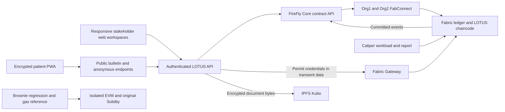

# LOTUS toolchain migration

Updated 14 October 2026. Requirements were checked against the supplied 18-page LOTUS project synopsis. LOTUS remains a responsive browser application, including its patient PWA. Hyperledger Fabric is the operational ledger.

## Tools that are implemented and used

| Tool | Pinned version | Working use | Evidence command |
| --- | --- | --- | --- |
| Hyperledger Fabric | 3.1.5 | Certificate-authorized lots, custody, permits, atomic dispensing, recalls and anonymous proof verification | `npm run test:fabric` |
| Hyperledger FireFly Core | 1.5.0 | Application contract API, ordinary command submission, scoped queries and durable commit-event indexing | `npm run test:firefly` |
| FireFly FabConnect | 0.10.0 | Actual TLS connections to both Fabric organizations, transaction submission and event streams | `scripts/firefly-start.sh` |
| Hyperledger Caliper | 0.7.1 | Fabric read latency, valid-commit latency, transaction outcomes and HTML reports | `npm run bench:caliper` |
| Brownie | eth-brownie 1.22.2 | Compiles the retained Solidity source, runs migration regression tests and records real EVM gas | `npm run test:brownie` |
| IPFS Kubo | 0.43.1 | Pins encrypted certificates/manifests; Fabric records CID and digests; authorized downloads retrieve actual IPFS bytes | `npm run test:ipfs` |
| Existing cryptographic tools | Repository versions | Browser commitments, Groth16 proofs, private matching and two-of-three guardian recovery | SDK, API and browser tests |

Caliper uses its official `fabric:fabric-gateway` binding with Fabric Gateway 1.7.1 and gRPC 1.13.1 in an isolated workspace. The business API uses Fabric Gateway 1.13.0 for confidential transient submissions. Brownie targets EVM contracts and cannot deploy Fabric chaincode. Primary sources: [FireFly](https://github.com/hyperledger-firefly/firefly), [Caliper Fabric binding](https://hyperledger-caliper.github.io/caliper/0.7.1/connectors/fabric-config/), [Brownie](https://eth-brownie.readthedocs.io/en/stable/quickstart.html), [IPFS RPC](https://docs.ipfs.tech/reference/kubo/rpc/).

## Application architecture



FireFly operates in gateway namespaces, one per peer organization, against the existing LOTUS chaincode. Token plugins and multiparty data exchange are unnecessary for the current workflows. The implementation does not invent a second business ledger.

Ordinary commands go through FireFly with the enrolled actor, public arguments and stable idempotency key. The API waits for successful confirmation and reads the authoritative `CommandResult` from Fabric. That query checks both the actor and canonical content digest. Changed retries fail; another actor cannot retrieve the receipt. An uncertain response preserves the browser's original request ID. A service failure never silently changes ledgers.

Dispense, batch fill and transfer requests carrying a permit credential deliberately use Fabric Gateway transient data. FireFly would persist ordinary request content in its operation database. Their resulting committed state and events still appear through FireFly. The patient root secret enters neither transport. Patients retain broad-feed local matching and anonymous proof submission.

IPFS receives AES-GCM ciphertext. Fabric contains the CID, original document digest and ciphertext digest. Authorization precedes decryption; downloads verify both digests. An encrypted database copy remains available for backup. A configured IPFS document fails visibly if its IPFS service is unavailable. The local Kubo node has loopback RPC, no swarm listeners, no public content announcements and offline mode. Consortium replication/pinning policy is a deployment choice.

## Synopsis feature mapping

The functional requirements are retained while EVM-specific choices are mapped explicitly.

| Synopsis feature | Migrated application | Verification or boundary |
| --- | --- | --- |
| Five actor types, roles and protected actions | Manufacturer, distributor, pharmacy, prescriber and regulator workspaces, plus operator/auditor access and individual Fabric enrollment | Wrong-role, revoked-actor and tenant tests; FireFly staff invitation/enrollment |
| Lot registration, expiry, certificates and manifests | Controlled issuance, immutable digests, document access, IPFS CIDs, pack QR and shipment records | Duplicate/quantity/expiry checks and real IPFS upload/download |
| Manufacturer → distributor → pharmacy custody | Two-sided shipping, receiving, rejection, forwarding and durable references | Accepted stock is required before use; rejected shipments restore correct stock |
| Dispense closure, returns and shrinkage | Available/transit/quarantine/dispensed/returned/loss accounting in atomic domain rules | API and contract invariants; Caliper inventory reconciliation |
| Stateful permits, partial fills and transfers | Expiring product balances, fresh credentials, pharmacy binding and holder-authorized transfer | Partial-fill/transfer tests; non-negative balances and failed-batch rollback |
| Split records and unique commitments | Fresh browser commitments; shared uniqueness checks; identifying counter records remain outside the ledger | Duplicate rejection, actual proof tests and patient-secret isolation |
| Immutable lot-scoped regulator recalls | Class I/II/III decisions, reasons/instructions and blocked subsequent dispensing | Wrong-role and immutability tests; FireFly indexes committed recalls |
| Event fan-out and regional aggregates | Durable FireFly listener, broad patient bulletin and protected regional release with complementary suppression | Event acceptance and aggregate tests; event indexing is not email/SMS delivery |
| Patient wallet, QR capture and exact matching | Encrypted PWA, saved issued indices, signed receipts, scanner and local matching | Complete browser flow, altered receipt rejection and offline matching |
| Two-of-three guardian recovery | Separate guardian browser vaults and encrypted full backup | Two shares restore the secret; backup restores permits and index history |
| Public QR verification | No-login product/lot status and role-only custody summary | Known/unknown/recalled/expired/offline outcomes; lot lookup cannot prove physical authenticity |
| Evaluation and failure sweeps | Retained research pipeline, source-preserving openFDA imports and isolated replay; real Caliper measurements and Brownie cost reference | Simulations remain labelled; tool smoke tests do not establish clinical notification sensitivity |
| Browser PWA; no native app | Phone-oriented patient/guardian and responsive staff interfaces | Phone layout, offline shell and encrypted storage tests |
| Solidity contract suite | Brownie's executable reference; shared business rules now run in Fabric | Six added Brownie tests plus retained Hardhat tests |
| Public Amoy address and gas budget | EVM reference remains available; Fabric certificates, endorsements and valid commits identify the operational deployment | No new Amoy deployment is claimed; Fabric has no EVM gas charge |

I1–I5 remain ledger invariants. I6, “never worse than conventional notification”, is a system/deployment condition: conventional channels must remain active independently. FireFly event indexing alone does not establish delivered notices or clinical reach. Guaranteed closed-browser matching, real delivery-provider integration, independent consortium administration and production key/time policy retain the deployment gates in `WEB_APPLICATION_GUIDE.md`.

Guardian replacement and full recovery are implemented. A compromised device cannot be made to forget a secret it already learned. The synopsis's old-epoch/new-epoch proof-based re-commit protocol is separate cryptographic migration work; it is not claimed by replacing guardian shares.

## Install and reproduce

This checkout has prepared local runtimes. Fresh environments need Node 22+, Python 3.13, Ubuntu WSL with user systemd, and the Fabric/portable Node runtime described in `WEB_APPLICATION_GUIDE.md`. FireFly compilation requires Ubuntu `gcc` and `libc6-dev`. Docker is not required for this network.

```powershell
npm ci
npm run tools:install
wsl -d Ubuntu -- bash /mnt/d/Projects/LOTUS/scripts/firefly-build.sh
```

The installer uses isolated, pinned Caliper/Brownie dependencies and checks the official Kubo archive SHA-256 before extraction. FireFly/FabConnect builds download immutable commits resolved from the official [FireFly 1.5.0 release](https://github.com/hyperledger-firefly/firefly/releases/tag/v1.5.0) and [FabConnect 0.10.0 release](https://github.com/hyperledger-firefly/fabconnect/releases/tag/v0.10.0), then check the repository-maintained archive SHA-256 pins before every extraction. These are locally recorded archive pins, not separately published maintainer checksums. Both release commits have verified GitHub signatures. Every build uses a fresh verified source tree and Go module checksum verification; an existing extracted directory cannot bypass the archive check. Files under `.tooling/` are ignored runtime material, not business inventory.

Create the separate tool channel once:

```powershell
wsl -d Ubuntu -- bash -c 'LOTUS_FABRIC_CHANNEL=lotus-tooling bash /mnt/d/Projects/LOTUS/scripts/fabric-native.sh'
node scripts/fabric-config.mjs channel=lotus-tooling operator=tooling-operator output=.fabric-network/tooling-gateway.json
npm run tools:prepare
npm run firefly:configure
wsl -d Ubuntu -- bash /mnt/d/Projects/LOTUS/scripts/firefly-start.sh
npm run firefly:register
```

Reuse an existing configuration rather than re-running bootstrap. Actor preparation reuses enrolled actors. The native launcher skips already committed chaincode definitions. Chaincode runs in a project-scoped user service so it survives the launcher finishing; pids/service names stay under `.fabric-network/`. No boot-time activation is configured. Local keepalive settings are aligned to prevent idle peer/orderer disconnections.

Start Kubo in a separate terminal, then execute the acceptance commands:

```powershell
npm run ipfs:start
```

```powershell
npm run test:firefly
npm run test:ipfs
npm run bench:caliper
npm run test:brownie
npm test
npm run build
npm run test:browser
```

Tool stock is confined to `lotus-tooling`. Temporary web users/databases are removed after tests. Test-only credentials in ignored Caliper fixtures must not be published as report artifacts. Brownie's EVM uses port 18545 and has a CI job that uploads only its JUnit result and gas summary.

## Enable the stack for a web profile

The delivered preview already uses the empty operational Fabric/FireFly/IPFS profile and is ready for operator setup. `npm start` selects it explicitly. The first person chooses their own password; the server binds the account to the pre-enrolled operator. A profile with existing Fabric business state cannot use first-run setup as an account-recovery shortcut. A stored profile marker blocks silent ledger/network changes.

For a fresh operational profile, use a separate FireFly runtime and ports so the tooling ledger can remain isolated:

```powershell
wsl -d Ubuntu -- bash /mnt/d/Projects/LOTUS/scripts/fabric-native.sh
node scripts/fabric-config.mjs channel=lotus-operations operator=operational-operator output=.fabric-network/gateway.json
$env:LOTUS_FABRIC_CONFIG = 'D:\Projects\LOTUS\.fabric-network\gateway.json'
$env:LOTUS_FIREFLY_RUNTIME = 'D:\Projects\LOTUS\.tooling\firefly\operations'
$env:LOTUS_FIREFLY_PORT = '5300'
npm run firefly:configure
$env:LOTUS_FIREFLY_CONFIG = 'D:\Projects\LOTUS\.tooling\firefly\operations\client.json'
wsl -d Ubuntu -- bash /mnt/d/Projects/LOTUS/scripts/firefly-start.sh /mnt/d/Projects/LOTUS/.tooling/firefly/operations
npm run firefly:register
npm start
```

Keep Kubo running in its separate terminal. Bootstrap only once. The supplied CLI paths reflect this Windows checkout; adapt its absolute root for another machine. `npm run start:local` and `npm run dev` use independent data directories. An already used local business profile requires reconciliation/cutover, not a mode toggle. FireFly and chaincode run as project-scoped user services and can be stopped using the supplied tracked-process scripts.

Operational APIs must not use the tooling channel. The client checks matching channel/chaincode. Internal FireFly/Kubo endpoints bind to loopback. Production needs protected internal APIs and separately administered organization nodes/identities. Imported cryptogen identities are an integration setting, not online Fabric CA enrollment.

The operator/auditor **Integrations** workspace distinguishes live selected-ledger/FireFly/IPFS status from historical Caliper/Brownie evidence and offers downloadable summaries without credentials or patient data.

## Measured evidence

The default Caliper run has one worker, one in-flight write, 24 evaluated reads, 12 committed registrations and 12 committed fills. Final dispense quantity and available stock are reconciled in Fabric. The initial contention run exposed real MVCC failures; serial operation is explicit in the final results. These are single-host integration measurements, not a demonstrated production TPS ceiling.

`LOTUS_BENCH_TRANSACTIONS` supports counts up to 100000. A larger transaction count does not establish a 100000-patient Synthea experiment. Multiple workers require independently prepared mutable state and a separate concurrency design; the shared-state fixture rejects that unsupported configuration.

Caliper outputs HTML, transaction ID/success/latency JSONL and a summary under `test-results/caliper/<run-id>/`. Commit measured sources and reload the local chaincode service before a run. Evidence records the source commit, source SHA-256 values and measurement time, and rejects uncommitted or changed measured inputs. Measured source files use LF line endings across platforms. Summary assembly rejects hashes that no longer match the current sources; updating hashes alone cannot validate a run. Incomplete/failed rounds prevent successful delivery of a summary even when Caliper's CLI exits with zero. Brownie outputs source SHA-256 and real transaction gas under `test-results/brownie/`; its tests cover partial fills/transfer/recall, duplicates, overspending, batch rollback, access control, absent custody and seeded closure attacks. Historical EVM calldata privacy limits remain documented.

`docs/toolchain-evidence.json` preserves the delivery snapshot. Current results are in `test-results/firefly/acceptance.json`, `test-results/ipfs/acceptance.json`, `test-results/caliper/latest.json` and the Brownie gas/JUnit files. `npm run tools:evidence` assembles the existing passing artifacts; their timestamps identify the runs. It retains the recorded synopsis digest by default, or hashes a separately supplied document with `npm run tools:evidence -- /path/to/synopsis.pdf`. Regenerating the summary does not rerun those tests. Large Synthea × openFDA campaigns, independent deployment, public testnet verification and a new manuscript are separate research/deployment deliverables; their completion is not inferred from smoke tests.
